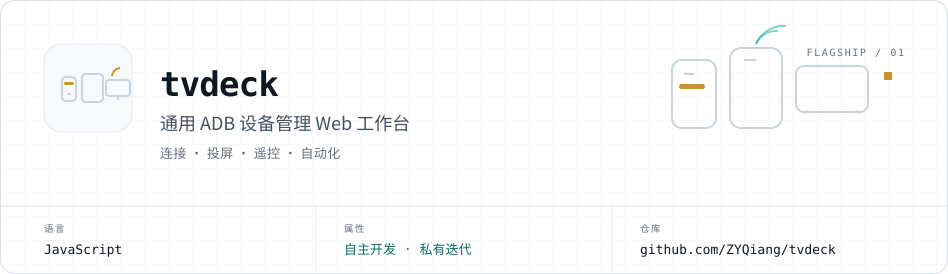
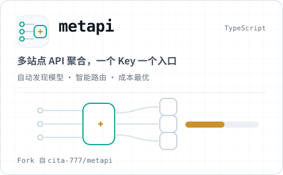
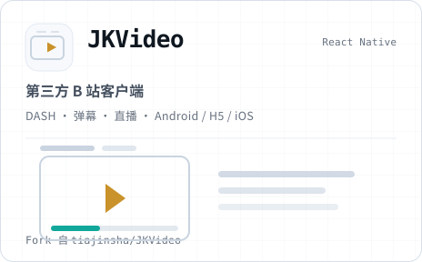

<picture>
  <source media="(prefers-color-scheme: dark) and (max-width: 600px)" srcset="./assets/hero-dark-mobile.svg">
  <source media="(prefers-color-scheme: dark)" srcset="./assets/hero-dark.svg">
  <source media="(max-width: 600px)" srcset="./assets/hero-light-mobile.svg">
  
</picture>

<h2 align="left">
  <picture>
    <source media="(prefers-color-scheme: dark) and (max-width: 600px)" srcset="./assets/title-stats-dark-mobile.svg">
    <source media="(prefers-color-scheme: dark)" srcset="./assets/title-stats-dark.svg">
    <source media="(max-width: 600px)" srcset="./assets/title-stats-light-mobile.svg">
    
  </picture>
</h2>

  <picture>
    <source media="(prefers-color-scheme: dark)" srcset="https://github-stats-alpha.vercel.app/api/?username=ZYQiang&cc=0F141C&tc=E6EDF3&ic=E8C87A&bc=26303C">
    
  </picture>
  <picture>
    <source media="(prefers-color-scheme: dark)" srcset="https://streak-stats.demolab.com/?user=ZYQiang&background=0F141C&border=26303C&stroke=2A3542&ring=7CE7D9&fire=E8C87A&currStreakNum=E8C87A&sideNums=7CE7D9&currStreakLabel=7CE7D9&sideLabels=7CE7D9&dates=7A8694&date_format=Y.m.d">
    
  </picture>

<h2 align="left">
  <picture>
    <source media="(prefers-color-scheme: dark) and (max-width: 600px)" srcset="./assets/title-projects-dark-mobile.svg">
    <source media="(prefers-color-scheme: dark)" srcset="./assets/title-projects-dark.svg">
    <source media="(max-width: 600px)" srcset="./assets/title-projects-light-mobile.svg">
    
  </picture>
</h2>

<a href="https://github.com/ZYQiang/tvdeck"><picture>
  <source media="(prefers-color-scheme: dark) and (max-width: 600px)" srcset="./assets/project-tvdeck-dark-mobile.svg">
  <source media="(prefers-color-scheme: dark)" srcset="./assets/project-tvdeck-dark.svg">
  <source media="(max-width: 600px)" srcset="./assets/project-tvdeck-light-mobile.svg">
  
</picture></a>

<a href="https://github.com/ZYQiang/metapi"><picture>
  <source media="(prefers-color-scheme: dark) and (max-width: 600px)" srcset="./assets/project-metapi-dark-mobile.svg">
  <source media="(prefers-color-scheme: dark)" srcset="./assets/project-metapi-dark.svg">
  <source media="(max-width: 600px)" srcset="./assets/project-metapi-light-mobile.svg">
  
</picture></a> <a href="https://github.com/ZYQiang/JKVideo"><picture>
  <source media="(prefers-color-scheme: dark) and (max-width: 600px)" srcset="./assets/project-jkvideo-dark-mobile.svg">
  <source media="(prefers-color-scheme: dark)" srcset="./assets/project-jkvideo-dark.svg">
  <source media="(max-width: 600px)" srcset="./assets/project-jkvideo-light-mobile.svg">
  
</picture></a>

<h2 align="left">
  <picture>
    <source media="(prefers-color-scheme: dark) and (max-width: 600px)" srcset="./assets/title-repos-dark-mobile.svg">
    <source media="(prefers-color-scheme: dark)" srcset="./assets/title-repos-dark.svg">
    <source media="(max-width: 600px)" srcset="./assets/title-repos-light-mobile.svg">
    
  </picture>
</h2>

共 27 个仓库 · 3 个自有项目 · 24 个学习/工具 fork

<table>
<thead>
<tr><th align="left">仓库</th><th align="left">说明</th><th align="left">类型</th></tr>
</thead>
<tbody>
<tr><td><a href="https://github.com/ZYQiang/edgetunnel">edgetunnel</a></td><td>VLESS 配置信息转换为订阅内容</td><td>Fork · JavaScript</td></tr>
<tr><td><a href="https://github.com/ZYQiang/MiSub">MiSub</a></td><td>订阅聚合管理</td><td>Fork · JavaScript</td></tr>
<tr><td><a href="https://github.com/ZYQiang/llm-chat-app-template">llm-chat-app-template</a></td><td>LLM 聊天应用模板</td><td>自有 · JavaScript</td></tr>
<tr><td><a href="https://github.com/ZYQiang/node-ws">node-ws</a></td><td>Serverless VLESS/Trojan 双协议</td><td>Fork · JavaScript</td></tr>
<tr><td><a href="https://github.com/ZYQiang/CF-Workers-SUB">CF-Workers-SUB</a></td><td>多订阅汇聚生成订阅链接</td><td>Fork · JavaScript</td></tr>
<tr><td><a href="https://github.com/ZYQiang/Paper">Paper</a></td><td>自动构建 Paper 服务器</td><td>Fork · Java</td></tr>
<tr><td><a href="https://github.com/ZYQiang/serv00-login">serv00-login</a></td><td>Serv00/CT8 批量保号</td><td>Fork · Python</td></tr>
<tr><td><a href="https://github.com/ZYQiang/IoTClient">IoTClient</a></td><td>PLC / ModBus / Bacnet 协议客户端</td><td>Fork · C#</td></tr>
<tr><td><a href="https://github.com/ZYQiang/maths">maths</a></td><td>加减法数学题生成器</td><td>Fork · 其他</td></tr>
<tr><td><a href="https://github.com/ZYQiang/datav-react">datav-react</a></td><td>Formily 可视化设计器</td><td>Fork · React</td></tr>
</tbody>
</table>

<h2 align="left">
  <picture>
    <source media="(prefers-color-scheme: dark) and (max-width: 600px)" srcset="./assets/title-contact-dark-mobile.svg">
    <source media="(prefers-color-scheme: dark)" srcset="./assets/title-contact-dark.svg">
    <source media="(max-width: 600px)" srcset="./assets/title-contact-light-mobile.svg">
    
  </picture>
</h2>

邮箱：<a href="mailto:yunzhanghao@live.com">yunzhanghao@live.com</a>

如果这些项目对你有帮助，欢迎 Star · 有想法就来 PR

