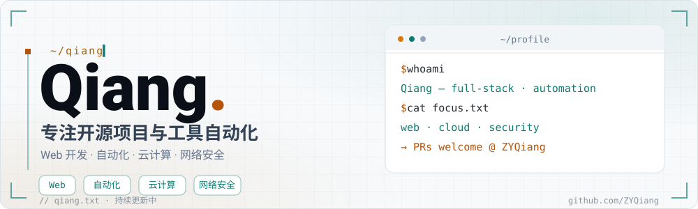

<picture>
  <source media="(prefers-color-scheme: dark) and (max-width: 600px)" srcset="./assets/banner-dark-mobile.svg">
  <source media="(prefers-color-scheme: dark)" srcset="./assets/banner-dark.svg">
  <source media="(max-width: 600px)" srcset="./assets/banner-light-mobile.svg">
  
</picture>

<h2 align="center">技术方向</h2>

  
  
  
  

<h2 align="center">精选仓库</h2>

<table align="center">
  <tr>
    <td align="center" valign="top" width="33%">
      <a href="https://github.com/ZYQiang/tvdeck"><b>tvdeck</b></a> 
      通用 ADB 设备管理 Web 工作台 
      连接 · 投屏 · 遥控 · 自动化 
      
    </td>
    <td align="center" valign="top" width="33%">
      <a href="https://github.com/ZYQiang/metapi"><b>metapi</b></a> 
      多站点 API 聚合 
      一个 Key 一个入口 
      
    </td>
    <td align="center" valign="top" width="33%">
      <a href="https://github.com/ZYQiang/JKVideo"><b>JKVideo</b></a> 
      第三方 B 站客户端 
      Android · H5 · iOS 
      
    </td>
  </tr>
</table>

<h2 align="center">GitHub 统计</h2>

  <picture>
    <source media="(prefers-color-scheme: dark)" srcset="https://streak-stats.demolab.com/?user=ZYQiang&hide_border=true&background=0F141C&ring=7CE7D9&fire=E8C87A&currStreakNum=E6EDF3&currStreakLabel=7CE7D9&sideNums=A9B4C0&sideLabels=A9B4C0&dates=8B98A8&date_format=Y.m.d" />
    
  </picture>

  
  

<h2 align="center">联系我</h2>

  

如果这些项目对你有帮助，欢迎 Star · 有想法就来 PR

